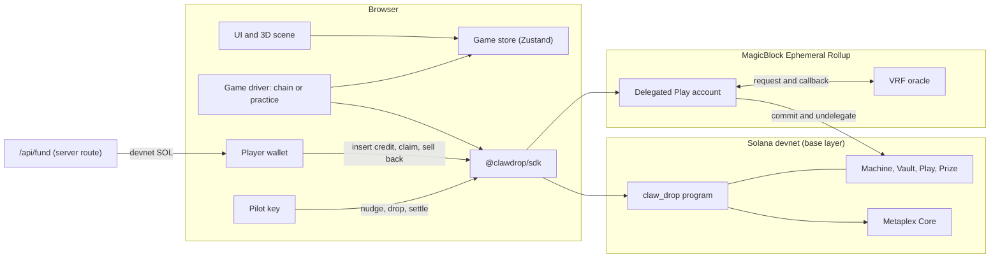
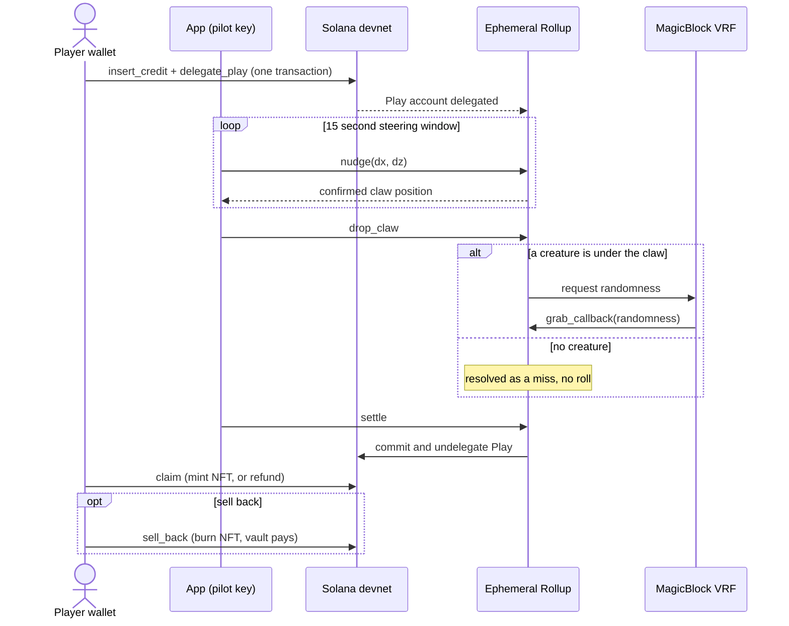
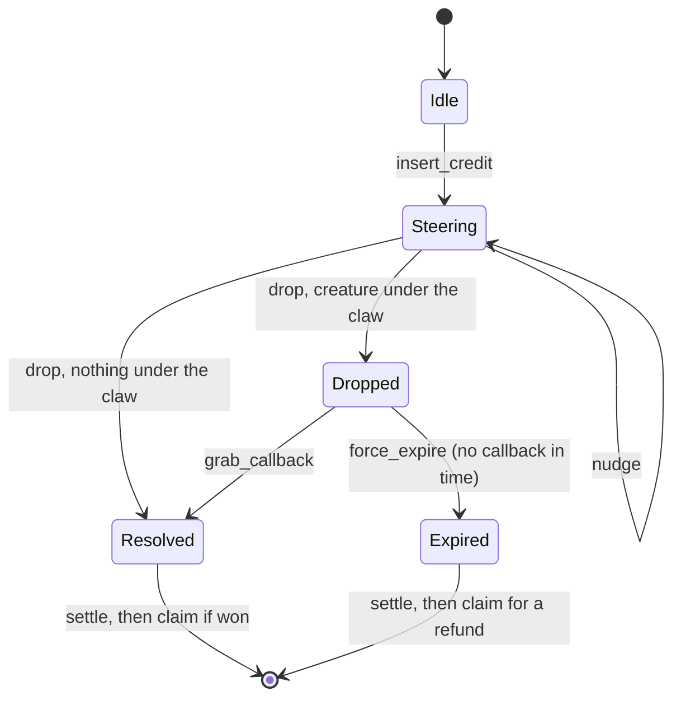

# Claw Drop

**Skill drops the claw. Luck you can verify.**

A provably fair on-chain claw machine on Solana. You steer the claw in real time on a MagicBlock Ephemeral Rollup, verifiable randomness decides whether the grip holds, and a creature you catch is minted to your wallet as a Metaplex Core NFT that you can keep or sell back to the machine.

> Built for **MagicBlock Solana Blitz v10**, theme *Entertainment Finance*.
> Runs on **Solana devnet only**. No real money is involved.
> "Claw Drop", the creature names and the artwork are working placeholders.

## Contents

- [Overview](#overview)
- [Creatures and odds](#creatures-and-odds)
- [Provable fairness](#provable-fairness)
- [Tech stack](#tech-stack)
- [Architecture](#architecture)
- [On-chain program](#on-chain-program)
- [Security design and trust assumptions](#security-design-and-trust-assumptions)
- [Devnet deployment](#devnet-deployment)
- [Getting started](#getting-started)
- [Testing](#testing)
- [Project structure](#project-structure)
- [Current limitations](#current-limitations)
- [Credits](#credits)
- [Built for v10](#built-for-v10)

## Overview

Arcade claw machines can secretly weaken the grip, and the player has no way to know. Claw Drop publishes the odds on chain, locks them in when your game starts, and lets anyone recompute the result.

A round works like this:

1. **Insert credit (0.05 SOL).** One wallet approval pays the credit, funds a temporary *pilot key* with 0.01 SOL, creates or resets your game account and delegates it to an Ephemeral Rollup.
2. **Steer for 15 seconds.** Each steering update is a rollup transaction signed by the pilot key, so no wallet popup interrupts play. The app shows the creature under the claw and your current grip chance.
3. **Drop.** The program fixes the drop point, finds the target circle and calculates the grip. If a creature is under the claw, it requests randomness from the MagicBlock VRF.
4. **Reveal.** The VRF callback lands inside the rollup and decides the result. A drop that misses every circle ends immediately, with no roll.
5. **Settle.** The finished game is committed back to Solana and undelegated.
6. **Claim, then keep or sell back.** A win is minted as a Metaplex Core NFT. Selling it back burns the NFT and pays a fixed SOL amount from the machine's vault.

The app has four screens:

| Route | What it is |
|---|---|
| `/` | Landing page |
| `/play` | The arcade: a 3D claw machine, wallet connection and the game |
| `/collection` | Your shelf: the creatures your wallet owns, with sell-back |
| `/fairness` | The machine's odds, read from its on-chain account, plus a tool that recomputes a play |

There is also a **practice mode** (`/play?practice=1`) that simulates the game in the browser. It needs no wallet or SOL, sends nothing to the chain, and is labelled as practice in the interface.

## Creatures and odds

The floor is a 1000 × 1000 grid. Every full-size plush in the machine sits on a target circle, so every one of them can be won. Rarer creatures have fewer, smaller circles.

| Creature | Rarity | Circles × radius | Grip, centre → edge | Sell-back | Supply cap | Best-case expected payout per drop |
|---|---|---|---|---|---|---|
| Pebble Crab | Common | 3 × 55 | 70% → 20% | 0.02 SOL | 10,000 | 0.014 SOL |
| Mochi Sprout | Uncommon | 2 × 45 | 50% → 12% | 0.05 SOL | 2,000 | 0.025 SOL |
| Volt Axolotl | Rare | 2 × 35 | 30% → 6% | 0.15 SOL | 500 | 0.045 SOL |
| Void Hopper | Epic | 1 × 28 | 12% → 2% | 0.40 SOL | 100 | 0.048 SOL |
| Gilded Wyrm | Legendary | 1 × 22 | 4% → 1% | 1.00 SOL | 25 | 0.040 SOL |

**House edge.** The last column assumes perfect aim, and every value is below the 0.05 SOL credit. The program enforces this: `set_slot` rejects a configuration where `base grip × sell-back` is not below the credit price. This limits the *expected* payout. It is not a guarantee against a lucky streak.

## Provable fairness

**Targeting.** A drop targets a circle if it is inside it or exactly on its edge. If circles overlap, the one with the smallest `d² / r²` wins. A tie goes to the lower creature slot.

**Grip** is highest at the centre of the circle you hit and falls in a straight line, in terms of squared distance, to the minimum at its edge:

```text
d²   = (x − cx)² + (z − cz)²
r²   = radius²
grip = min + (base − min) × (r² − d²) / r²      (basis points, rounded down)
```

**The roll** uses 32 random bytes from the MagicBlock VRF, read as one big-endian 256-bit integer:

```text
roll = randomness mod 10000
won  = roll < grip
```

The program uses integer maths only, with no floating point. The same rules are ported to TypeScript in [`packages/sdk/src/grip.ts`](packages/sdk/src/grip.ts) and drive the live grip readout and the recompute tool on the Fairness page. The on-chain version is [`programs/claw-drop/src/grip.rs`](programs/claw-drop/src/grip.rs).

**Locked odds.** When you insert a credit, the current odds are copied into your game account. Changing the machine afterwards cannot change a game already in progress.

## Tech stack

| Layer | Technology |
|---|---|
| On-chain program | Rust, Anchor (`anchor-lang` 1.0.2) |
| Real-time execution | MagicBlock Ephemeral Rollups (`ephemeral-rollups-sdk` 0.16.2) |
| Randomness | MagicBlock VRF, requested and fulfilled inside the rollup |
| Prizes | Metaplex Core NFTs (`mpl-core` 0.12.1) |
| Client SDK | TypeScript, `@coral-xyz/anchor`, `@solana/web3.js` |
| Web app | Next.js 15 (App Router), React 19, TypeScript, Tailwind CSS 3.4 |
| State | Zustand |
| 3D and animation | three.js 0.170, dotLottie |
| Wallets | Solana Wallet Standard, Mobile Wallet Adapter (Android), in-browser test wallet |
| Testing | Vitest, `cargo test` |
| Package manager | pnpm workspaces |

## Architecture

### System



### One game



### Two connections

The app talks to two endpoints. Machine setup, credits, claims and sell-backs go to the **base layer**. Steering, dropping and settling go to the **rollup**. The `Machine` account is never delegated; the rollup only touches the player's `Play` account, which carries its own snapshot of the odds.

### Front-end layers

| Layer | Location | Rule |
|---|---|---|
| SDK | `packages/sdk` | No React. PDAs, transaction builders, connections, pilot key, subscriptions and grip maths |
| Game | `app/game` | One Zustand store is the source of truth. A chain driver and a practice driver share one interface |
| Scene | `app/scene` | Plain three.js. It reads the store and never calls the chain |
| UI | `app/ui` and route folders | React components |

`@clawdrop/sdk/model` exports the constants, slot table and grip maths without web3.js, so pages such as the landing page stay light. The chain driver is loaded only when it is needed.

### Steering over a network

The claw on screen moves immediately. Behind it, the app sends the difference between where you want the claw and where the transactions already sent will put it, with at most two in flight. A faint ghost marker shows the position the chain has confirmed, and the drop uses the confirmed on-chain position.

## On-chain program

Source: [`programs/claw-drop`](programs/claw-drop)

### Accounts

| Account | PDA seeds | Purpose |
|---|---|---|
| `Machine` | `["machine", authority]` | Credit price, collection and the five prize slots, each with up to 3 circles |
| Vault | `["vault", machine]` | Holds credits; pays sell-backs and refunds |
| `Play` | `["play", machine, player]` | One game: state, claw position, odds snapshot, randomness result. Delegated while playing |
| Prize asset | `["asset", play, game number]` | The Metaplex Core NFT |
| `Prize` | `["prize", asset]` | Receipt that records the sell-back value and whether it has been paid |

### Game states



A finished game can be replaced by a new one, except when it still holds an unclaimed win or refund.

### Instructions

| Instruction | Layer | Who can call it | What it does |
|---|---|---|---|
| `init_machine` | Base | Authority | Creates the machine, paused |
| `create_collection` | Base | Authority | Creates the Core collection, controlled by the machine PDA |
| `set_slot` | Base | Authority | Sets a creature's circles, odds, sell-back and supply cap |
| `set_paused` | Base | Authority | Pauses or opens the machine |
| `set_uri_prefix` | Base | Authority | Sets the NFT metadata base URL |
| `close_machine` | Base | Authority | Closes the machine account so it can be re-created after a layout change. The vault balance stays |
| `set_collection` | Base | Authority | Reconnects a re-created machine to a collection it already controls |
| `insert_credit` | Base | Player | Takes the credit, funds the pilot key and starts a game |
| `delegate_play` | Base | Player | Delegates the game to an allowed rollup validator. Sent in the same transaction as `insert_credit` |
| `nudge` | Rollup | Pilot | Moves the claw, within the steering window |
| `drop_claw` | Rollup | Pilot | Fixes the drop point and requests randomness if needed |
| `drop_claw_timeout` | Rollup | Anyone | Drops for a player whose window and grace period have passed |
| `grab_callback` | Rollup | VRF identity | Applies the randomness |
| `force_expire` | Rollup | Anyone | Expires a game whose callback did not arrive within 30 seconds |
| `settle` | Rollup | Pilot or player | Commits and undelegates a finished game |
| `claim` | Base | Player | Mints the prize, or refunds the credit if the game expired or the supply cap was reached |
| `sell_back` | Base | Current NFT owner | Burns the prize and pays its sell-back |

## Security design and trust assumptions

**What the program enforces**

- **Validator allow-list.** A game can be delegated only to the listed MagicBlock devnet validators. Otherwise a player could choose their own validator and commit a fake win.
- **Authenticated randomness.** The callback requires the VRF signer scoped to this program.
- **No replayed callbacks.** Each game has a number. A callback for an earlier game is ignored.
- **One claim per game.** A claimed flag and a per-game asset address both prevent a second mint.
- **Prizes are not overwritten.** A new game cannot start while the last one holds an unclaimed win or refund.
- **Limited pilot key.** It signs steering, dropping and settling for its own game. It cannot claim a prize or spend from your wallet. It is stored in your browser and funded with 0.01 SOL.

**What you still have to trust**

- The rollup validator correctly executes and commits the delegated game.
- The program's upgrade authority can upgrade the program.
- The machine authority can change odds for *future* games, pause the machine and re-create the machine account, which resets the minted counters used for supply caps.
- A game starts only if the vault can cover the largest single sell-back. The vault does **not** reserve funds for every unsold prize.

This code has not been audited.

## Devnet deployment

| Item | Address |
|---|---|
| Program | [`CSA1f5uS1W8AgdE1esXcujmZ9FUHan3icDXXRwFiyhdG`](https://explorer.solana.com/address/CSA1f5uS1W8AgdE1esXcujmZ9FUHan3icDXXRwFiyhdG?cluster=devnet) |
| Machine | [`BTCGfqsBsGchZC2nBUP4GkGuZ15HFNK3gCuKmjX2DSwV`](https://explorer.solana.com/address/BTCGfqsBsGchZC2nBUP4GkGuZ15HFNK3gCuKmjX2DSwV?cluster=devnet) |
| Vault | [`J3z4eFEEkaA3qe3nY458oQpG9T7MAHnVwQ7FarBHX6Gx`](https://explorer.solana.com/address/J3z4eFEEkaA3qe3nY458oQpG9T7MAHnVwQ7FarBHX6Gx?cluster=devnet) |
| NFT collection | [`Fdm1q8Nc8gQ8GEm63LG2tUjbxCePMHf2zfqCqDZahY4Y`](https://explorer.solana.com/address/Fdm1q8Nc8gQ8GEm63LG2tUjbxCePMHf2zfqCqDZahY4Y?cluster=devnet) |

| Endpoint or identity | Value |
|---|---|
| Base RPC | `https://rpc.magicblock.app/devnet` |
| Rollup (EU) | `https://devnet-eu.magicblock.app` |
| Allowed validator (EU) | `MEUGGrYPxKk17hCr7wpT6s8dtNokZj5U2L57vjYMS8e` |
| Allowed validator (US) | `MUS3hc9TCw4cGC12vHNoYcCGzJG1txjgQLZWVoeNHNd` |
| Rollup VRF queue | `5hBR571xnXppuCPveTrctfTU7tJLSN94nq7kv7FRK5Tc` |

Example base-layer transactions from an end-to-end run against this deployment:

- [Insert credit and delegate](https://explorer.solana.com/tx/hbKU5fQ9MXDHbcy8nbH9Y5SqPWVNmVSttMdpZ4fM3Uj1MFXfNo6UZM4R3iJrKRCVBh6nyQDairRpLpcP8yAAqM5?cluster=devnet)
- [Claim: mint the Core NFT](https://explorer.solana.com/tx/4Zv8eVovpVimQ3wNPMvBFdD8hcGtJzviKVuT8xYctXM6KMukxXUocsRnXJKPjVzrVKLc2DccdGZNgCFxLffmvo8v?cluster=devnet)
- [Sell back: burn and pay out](https://explorer.solana.com/tx/52CdCVLv7m8ASffwna1s5nyG4c9fe7GqroJ9f4drgi9ji5VqZqiH7FJFQ7VKMKYbuXvxfGHnMkgxvBaVkLyvTmhg?cluster=devnet)

## Getting started

### Prerequisites

To run the web app:

- [Node.js](https://nodejs.org) (tested with 24.18)
- [pnpm](https://pnpm.io) (tested with 10.33)

To build or test the program, you also need:

- Rust (tested with 1.95)
- Solana CLI (tested with 3.1.15)
- Anchor CLI (tested with 1.1.2)

### Clone and run

```bash
git clone <your-repo-url> claw-drop
cd claw-drop
pnpm install
pnpm dev
```

Open <http://localhost:3000>. You do not need an `.env` file: the app connects to the devnet deployment listed above.

### Try it in practice mode

Open <http://localhost:3000/play?practice=1>. No wallet or SOL is needed. To return to the chain game in the same tab, open `/play?practice=0`.

### Play on devnet

1. Open `/play` and connect a wallet. Set a browser wallet to **devnet**, or choose **Test wallet (this browser)**.
2. Get devnet SOL. A round uses 0.05 SOL for the credit and 0.01 SOL for the pilot key, plus a small amount for fees and account rent. Claiming a prize also pays rent for the new accounts. Use the [Solana devnet faucet](https://faucet.solana.com), or the in-app **Fund for testing** button if the deployment has it configured.
3. Insert a credit, approve once, and play.

> The test wallet is a throwaway key kept in your browser's local storage. Use it for devnet only.

### Environment variables

All are optional. To set any, copy the example file:

```bash
cp .env.example .env.local
```

| Variable | Side | Purpose |
|---|---|---|
| `FUNDING_KEY` | Server only | Secret key of a **devnet** treasury wallet, as a JSON byte array. Enables **Fund for testing**. If unset, `/api/fund` returns 404 |
| `NEXT_PUBLIC_BASE_RPC` | Browser and server | Replaces the base-layer RPC |
| `NEXT_PUBLIC_ROLLUP_URL` | Browser | Replaces the rollup endpoint |
| `NEXT_PUBLIC_MACHINE_AUTHORITY` | Browser | Points the app at the machine owned by another authority |
| `NEXT_PUBLIC_MODE` | Browser | Set to `practice` to run in practice mode only |
| `NEXT_PUBLIC_QA` | Browser | Set to `1` to show the QA state tools |

Never commit `.env.local` or a key file. Variables beginning with `NEXT_PUBLIC_` are visible in the browser, so never put a secret in one.

**Funding limits.** Each grant is 0.25 SOL. The limits are 2 grants per wallet and 4 per IP address per hour. Wallets holding 1 SOL or more are refused, and the route keeps at least 0.3 SOL in the treasury. The rate-limit counts are held in memory, so they reset on restart and are not shared between server instances.

### Production build

```bash
pnpm build
pnpm start
```

## Testing

```bash
pnpm typecheck                  # TypeScript type check
pnpm test                       # grip maths, slot layout, practice driver, steering planner, funding rules
cargo test -p claw-drop --lib   # program: grip maths, state machine, slot rules, claim planning
```

To build the program:

```bash
anchor build
```

On a fresh clone, Anchor may generate a new local program keypair and change `declare_id!` to match it. Check your diff afterwards. Deploying your own copy also needs your own program ID and your own machine setup. The operator scripts for machine setup are not included in this repository.

The client IDL in `packages/sdk/src/idl.ts` is generated and committed, so you can run the web app without building the program.

## Project structure

```text
.
├── programs/claw-drop/     Anchor program
│   └── src/
│       ├── lib.rs          Instructions and account contexts
│       ├── state.rs        Accounts and the game state machine
│       ├── grip.rs         Targeting, grip and roll maths
│       ├── errors.rs
│       └── instructions/   One file per handler or helper
├── packages/sdk/           TypeScript SDK (no React)
├── app/                    Next.js app
│   ├── landing/            Landing page sections
│   ├── play/               Arcade
│   ├── collection/         Your shelf
│   ├── fairness/           Odds and play audit
│   ├── api/fund/           Devnet funding route
│   ├── game/               Store and game drivers
│   ├── scene/              three.js machine and creatures
│   ├── wallet/             Wallet connection
│   ├── ui/                 Shared components
│   └── theme/              Design tokens and branding
├── public/                 Fonts, animations and the Lottie player
└── mockup/                 Original UI design mockups
```

## Current limitations

- **Devnet only.** The program is unaudited and not intended for real funds.
- **Placeholder branding.** The product name, creature names and art are not final.
- **NFT metadata is not hosted yet.** The collection uses a placeholder metadata URL, so wallets and explorers will not show prize images.
- **Device testing is incomplete.** Frame rate on phones and the connection flows for real wallets, including Mobile Wallet Adapter, have not yet been verified on physical devices.
- **The expiry path is only unit-tested.** `force_expire` has not been exercised on devnet.
- **Aiming can be automated.** A script could steer precisely, which is why the house edge is calculated for perfect aim.

## Credits

- Animations from [LottieFiles](https://lottiefiles.com): *Cute Monsters* and *Funny Monsters* by Abdul Latif, *Hands Holding a Joystick*, and *Gift Box*.
- Animation player: [`@lottiefiles/dotlottie-web`](https://github.com/LottieFiles/dotlottie-web).
- Fonts: Clash Display and Satoshi from [Fontshare](https://www.fontshare.com); Fredoka, Inter and JetBrains Mono from [Google Fonts](https://fonts.google.com).
- Built on [Solana](https://solana.com), [MagicBlock](https://www.magicblock.xyz), [Anchor](https://www.anchor-lang.com) and [Metaplex Core](https://developers.metaplex.com/core).

## Built for v10

Claw Drop was built for **MagicBlock Solana Blitz v10**, under the theme **Entertainment Finance**: a familiar arcade game where the odds are public, the result can be checked, and a prize is an asset you own.

It uses MagicBlock for two parts of every game:

- **Ephemeral Rollups** for steering, so each move is a real transaction without a wallet popup.
- **VRF inside the rollup** for the grip roll, so the result arrives during the game and can be verified.
